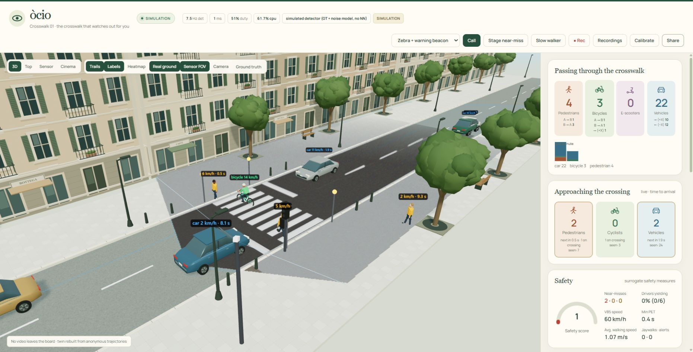
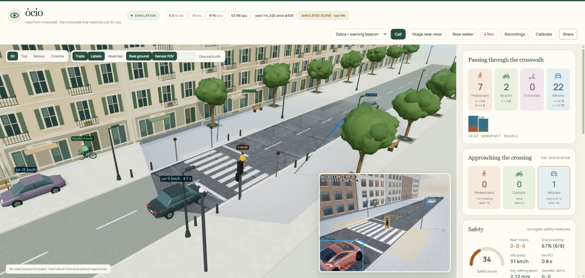
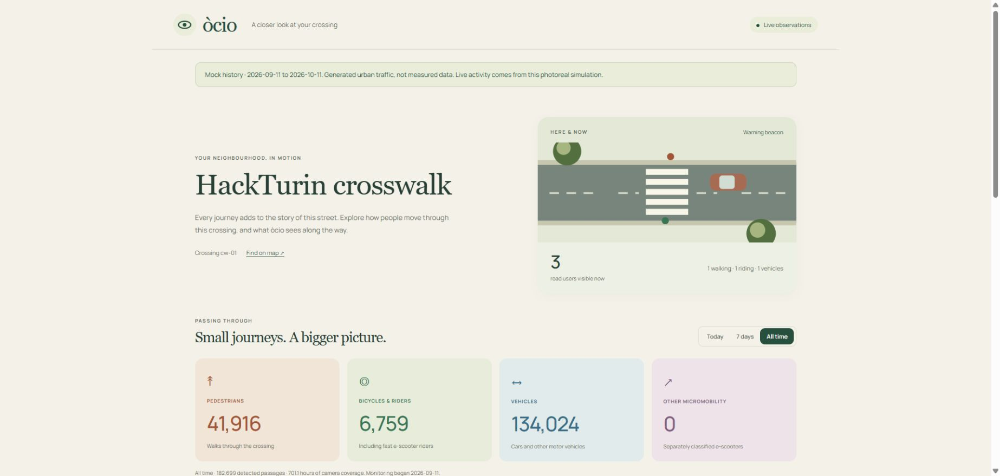
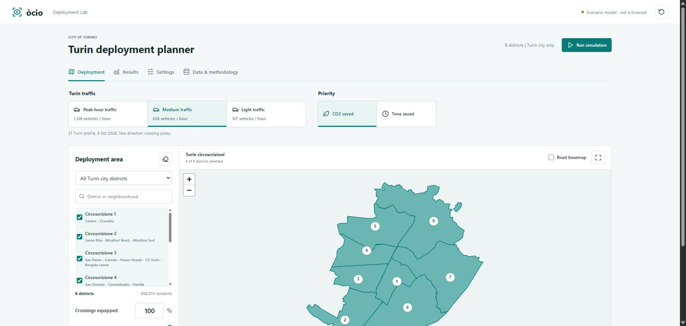
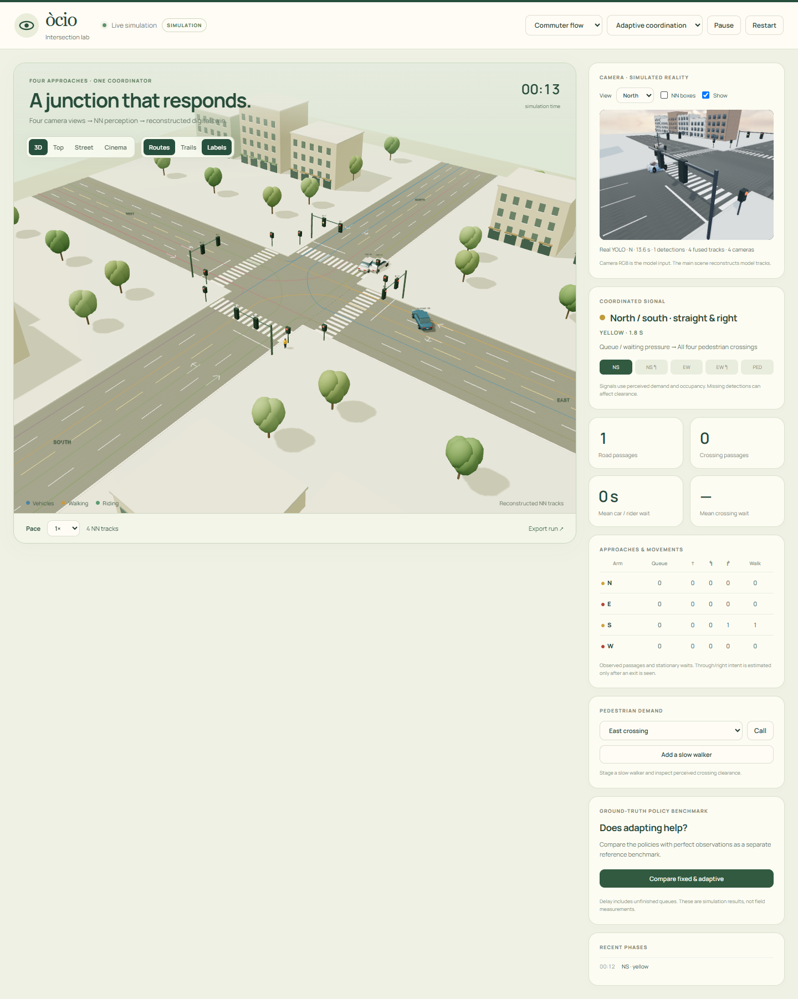

<div align="center">

# òcio

### The crosswalk that watches out for you.

**Local vision. Responsive signals. A street you can understand.**

HackTurin 2026 · GOMA Elettronica Smart Crossing challenge

[Watch the demo](data/videos/submission/ocio_v3.mp4) · [Try it locally](#try-it) · [Measured results](#measured-results) · [Hardware](docs/HANDOFF_LIVE_GPIO.md)

</div>



*The operator dashboard, running synthetic traffic on a laptop. The 3D street is rebuilt from anonymous tracks.*

òcio turns a camera and an **Arduino UNO Q** into a crossing that sees approaching road users, counts their journeys, measures close encounters, and drives a signal by explicit rules. Vision runs locally; the STM32 controls the outputs. The deployed node works offline.

## One crossing. Six ways to see more.

| | |
|:--|:--|
| **See in metres** — YOLO detection, zebra-stripe calibration, bird’s-eye tracking, rider fusion and recovery after occlusion. | **Count the journeys** — pedestrians, bicycles and vehicles by direction, including return crossings; walking speeds, crossing times and vehicle V85. |
| **Spot close encounters** — time to collision, required braking and post-encroachment time; yielding, speeding, red-light and blocked-crossing indicators. | **Respond to people** — camera or manual calls, adaptive pedestrian phases, “Green Man+” clearance for slow walkers, and a warning-beacon mode. |
| **Explore the street** — 3D, top, sensor and cinema views; trails, heatmaps, field of view, live decisions and anonymous 3D event replays. | **Share the bigger picture** — a citizen page through QR, persistent traffic history, and a Turin deployment planner for costs, time and CO₂. |

### Real pixels → real neural network → digital twin



The photoreal simulator renders traffic into RGB frames and feeds the **actual detector**. Compare detections with a separate ground-truth layer, stage a near-miss, then switch to adaptive control. The fast simulator uses deliberately noisy virtual detections for repeatable tests.

### A crossing anyone can read



**Share → scan → explore.** The public page shows daily and weekly totals, rush-hour patterns, directions, speeds and safety indicators. SQLite keeps real-camera history across restarts; resetting the operator counters preserves that history. The public page contains aggregates rather than images or individual trajectories.

*This screenshot uses clearly labelled synthetic history. Real deployments collect their own observations.*

### From one zebra to a city



Select Turin’s **eight circoscrizioni**, choose coverage and traffic, then compare time or CO₂ priorities. Explore installation, maintenance, replacement, electricity, idle fuel and social value; save comparisons and export CSV/JSON. Sources and assumptions travel with the report. Results are conditional scenario estimates.

### Four cameras. One intersection.

The optional intersection lab adds four crossings, twelve vehicle movements and protected signal phases. Synchronized **N/E/S/W cameras → ONNX inference → fused metric tracks** drive the reconstructed twin and perceived queues. Stale observations hold all red. Fixed/adaptive comparisons use identical arrivals in a separate perfect-observation benchmark.

<details>
<summary><strong>See the four-camera intersection lab</strong></summary>



*A laptop prototype. Intersection detection accuracy and field control safety remain unvalidated.*

</details>

## Built for the edge

```text
Camera → local YOLO → metric tracker → counts + safety + signal rules
                                                ├─ STM32 → lamps / buzzer / displays
                                                └─ web dashboard + public statistics
```

The UNO Q’s Linux side runs NCNN YOLO11n at 320 px with motion gating and configurable inference rates. The STM32 owns a **2-second heartbeat watchdog**. Stale camera frames stop heartbeats; camera reopen logic and systemd restore the pipeline. The current Grove setup includes traffic LEDs, a passive buzzer, OLED and LED matrix.

Routine monitoring uses anonymous tracks. The optional debug stream pixelates heads and the vehicle plate band. **Raw recording is an explicit local tool** for evaluation and training; real-site footage stays out of Git. Keep operator controls private; expose only the read-only `/public/` routes through a public gateway.

## Measured results

| Check | Result | Evidence boundary |
|:--|:--|:--|
| Real-site counting | **20/20**, no false counts | One 105-second clip: 17 pedestrian and 3 car passages; no cyclists |
| Live board detection | **~6 Hz** | IMX219 + NCNN YOLO11n 320; benchmark ~9 Hz |
| Pedestrian waiting | **−46%** · 23.4 → 12.7 s | Paired fixed/adaptive simulator experiment |
| Serious conflicts | **16 → 0** | Same dangerous simulated traffic, beacon → adaptive |
| Near-miss detection | **48% precision / 62% recall** | Dangerous traffic with noisy virtual detections |
| Repository tests | **233 passed, 1 skipped** | Laptop suite, 11 October 2026; GPU test opt-in |

These measure different layers. Near-miss flags are screening indicators; bicycle detection at 320 px remains weak. Physical watchdog timing, scored live crossing trials and a complete 30-minute Grove soak remain incomplete.

[Simulator validation](docs/VALIDATION.md) · [Board evidence](docs/board_results/LIVE_GPIO_RESULTS.md) · [Known simulator limits](sim/DIVERGENCES.md)

## Try it

Use Python **3.11+** on a laptop. The fast demo needs no camera, model weights or downloaded scene assets.

```bash
python -m venv .venv
# Activate: source .venv/bin/activate      (Linux/macOS)
#           .venv\Scripts\Activate.ps1    (PowerShell)
python -m pip install -r requirements-board.txt
python -m crosswalk --sim mixed --port 8000
```

Open **[localhost:8000](http://localhost:8000)**. Try **Stage near-miss** in *Zebra + warning beacon*, switch to *Adaptive signal*, or add a **Slow walker**. Citizen statistics are at `/public/`; calibration is at `/calibrate.html`.

Run these separately to explore the other apps:

```bash
# Turin deployment planner → http://localhost:8020
python tools/economics_app.py --port 8020

# Four-arm intersection → http://localhost:8010
python -m crosswalk --intersection --intersection-scenario commute --port 8010
```

<details>
<summary><strong>Photoreal demos with actual YOLO inference</strong></summary>

Install `requirements-dev.txt` plus `playwright`, and have Chrome available. Export models with `tools/export_models.py`; fetch the licensed scene bundle with `tools/fetch_sim_assets.py`. Weights and downloaded assets are excluded from Git.

```bash
# Original crossing → http://localhost:8004
python tools/sim_run.py --scenario mixed --fps 5 --realtime --set sim.browser=chrome --port 8004

# Four-camera intersection → http://localhost:8010
python -m crosswalk --intersection --intersection-render photoreal --intersection-detector real --intersection-model models/yolo11n_416.onnx --port 8010
```

</details>

## Under the hood

| Code | What lives there |
|:--|:--|
| [`crosswalk/`](crosswalk/) | Capture, inference, tracking, counting, safety, signal, MCU link, recorder and web API |
| [`dashboard/`](dashboard/) | Three.js twin, citizen page, calibration and recording controls |
| [`firmware/`](firmware/) | STM32 outputs, Grove hardware profile and watchdog |
| [`sim/`](sim/) | Traffic world, noisy detections, photoreal rendering and intersection lab |
| [`economics/`](economics/) | Turin data, paired queue experiments, appraisal model and planner UI |
| [`tools/`](tools/) · [`tests/`](tests/) | Evaluation, model export/training, board acceptance and regression checks |

```bash
python -m pytest -q tests
```

[Board setup](docs/BOARD_SETUP.md) · [Live Grove deployment](docs/HANDOFF_LIVE_GPIO.md) · [Citizen page](docs/PUBLIC_CROSSING.md) · [Economics](docs/HANDOFF_ECONOMICS.md) · [Intersection](docs/INTERSECTION.md)

---

Built at **HackTurin 2026** for **GOMA Elettronica**. Three.js: MIT · Manrope: SIL OFL 1.1 · Ultralytics YOLO: AGPL-3.0. Renderer asset attribution and licences: [sim/ASSETS.md](sim/ASSETS.md).

**Federico Mustich, Enrico Sabbatini** and **Federico Fantastico**
